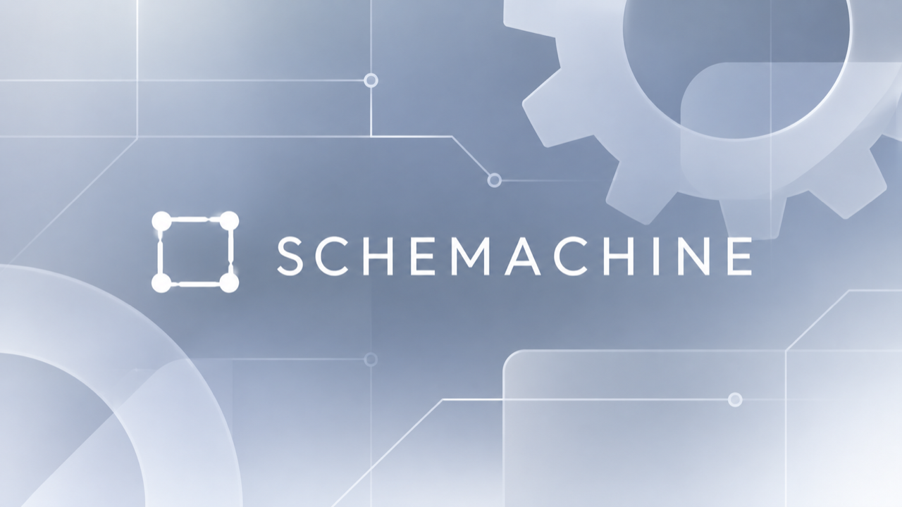

# SCHEMACHINE

**Interactive circuit design, mechanical assembly, and real-time physics simulation in a single workspace.**

SCHEMACHINE is a sandbox that brings circuit placement and wiring, mechanical part assembly, and 3D physics simulation with Rapier together in the browser. Circuit states can control motors and other hardware through a real-time simulation loop.

<p align="center">
  
</p>

## Features

- Circuit editor: components and wiring for batteries, resistors, diodes, transistors, MOSFETs, operational amplifiers, and more
- Real-time circuit analysis: immediate simulation of switches, motors, LEDs, buzzers, relays, sensors, and more
- 3D mechanical studio: place and connect plates, chassis, wheels, gears, wings, thrusters, and propellers
- Physics engine: 3D rendering with Three.js and rigid-body, joint, collision, and constraint simulation with Rapier
- Joints: weld, pin, motor, and slider joints
- Circuit and hardware integration: bidirectional component binding by name
- Project persistence: save and load `.schemachine.json` files and automatic browser local-storage saving
- Part Studio: custom mesh generation and STL import
- Presets: quickly start from games and example configurations
- Undo/Redo, zoom, grid, inspector, and other editing controls

## Tech Stack

- React 18 / TypeScript
- Vite 5
- Three.js
- Rapier3D compat
- Express
- tsx

## Requirements

- Node.js 18 or newer recommended
- npm
- Modern browser with WebGL support

## Setup

```bash
git clone https://github.com/AInohogosya/Schemachine.git
cd Schemachine
npm install
npm run dev
```

Open <http://localhost:5173> in your browser.

On Windows, run the included `start.bat`. On Linux or macOS, run `start.sh`. These scripts install dependencies and start the application together.

## Production Build

```bash
npm run build
npm run preview
```

The generated files are written to `dist/`.

To serve the build with the Express server:

```bash
npm start
```

Alternatively, build first and then run:

```bash
npm run serve
```

The default server port is selected according to the environment.

## Tests

```bash
npm test
```

Run individual test suites:

```bash
npm run test:components
npm run test:undo
npm run test:runtime
npm run test:headless
npm run test:render
```

Run type checking and verify the production build:

```bash
npm run typecheck
npm run build
```

## Saving and Loading Projects

Press **Save** in the toolbar to download the current circuit and hardware configuration as a `.schemachine.json` file. Use **Load** to select a project file and restore it.

The editor also automatically saves changes to `localStorage`. Loading legacy `.fable.json` files and `fablegame.autosave.v1` data is also supported.

For details about AI-generated project files, see [AI_GUIDE.md](AI_GUIDE.md).

## Directory Structure

```text
.
├── src/
│   ├── circuit/       Circuit components and wiring
│   ├── physics/       Physics simulation, rigid bodies, and joints
│   ├── presets/       Preset projects
│   ├── render/        2D rendering
│   ├── render3d/      3D rendering with Three.js
│   ├── sim/           Circuit and runtime simulation
│   ├── studio/        Part Studio
│   ├── sync/          Circuit and hardware synchronization
│   ├── ui/            React UI, editor, and input/output
│   ├── main.tsx       Application entry point
│   ├── store.ts       State management
│   └── types.ts       Shared data types
├── server/            Express delivery server
├── test/              Headless, integration, and render tests
├── AI_GUIDE.md        `.schemachine.json` format guide
├── index.html         HTML entry point
├── package.json       Scripts and dependencies
└── vite.config.ts     Vite configuration
```

## License

SCHEMACHINE is licensed under the [MIT License](LICENSE).
